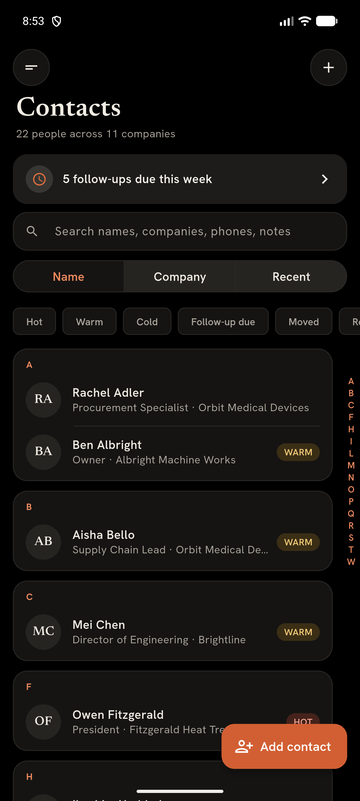
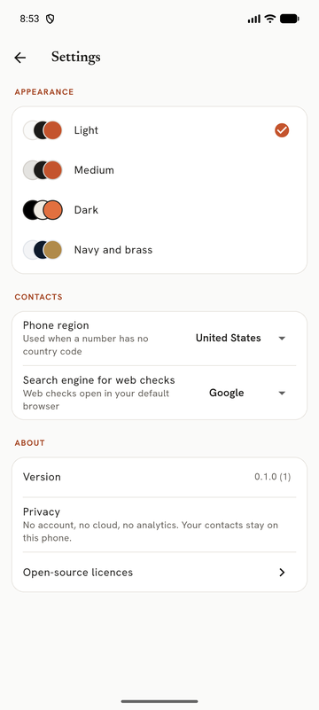

# CardKeep


**A business card organizer that keeps everything on your phone.** Photograph a card and CardKeep straightens it,
reads it, fills in the contact and keeps the card with them. No account, no cloud, no tracking.

<p>
  
  
  
  
</p>

## What it does (0.2.0)

- **Scan cards with the camera.** It finds the card, waits until it's sharp and steady, and captures by itself.
  Glare, blur, low light and cut-off cards get a hint before the shot and a flag after it.
- **Read on the phone.** The card is straightened and read with on-device text recognition; name, title, company,
  phones, emails, website and address land in the right fields. Anything it isn't sure of is marked for a second look.
- **QR codes too.** A contact QR on the card fills the details exactly. A web-link QR shows the real site, warns about
  link shorteners and look-alike addresses, and only opens when you tap it.
- **Batch and pile.** Shoot a stack of cards one after another, or several on a table in one photo. Clear cards go
  straight to Contacts; the rest wait in a review queue. Nothing is lost if the app closes mid-scan.
- **Review fast.** Tap any line of text on the card to put it in a field, or draw a box to read just that part.
- **Your contacts, quickly.** Search by any part of a name, company, email or phone number. Call, text, email, open
  the website or the address in your own apps. Lead ratings, follow-up dates, dated notes and a "check on web" search.
- **Themes.** Light, Medium and Dark with orange accents, or follow the phone's dark mode.
- **Updates from inside the app** (Settings → Updates), only when you ask.

<p>
  
  
</p>

## Install (Android)

1. Open the [latest release](../../releases/latest) on your phone and download `CardKeep-<version>-arm64-v8a.apk`
   (most phones from the last several years; use `armeabi-v7a` for older 32-bit phones).
2. Open the file and allow installing from your browser or files app when Android asks.
3. Open **CardKeep**.

**Updating:** Settings → Updates → *Check for updates* downloads and installs the new version over the old one.
Your contacts stay. Installing a newer APK by hand works the same way; there's no need to uninstall.

## Privacy

- Your contacts and card photos stay in CardKeep's private storage on the phone. Photos are saved without location
  or camera data.
- Cards are read on the phone; nothing is uploaded. No account, no analytics, no ads.
- Links, calls, emails and maps open in your own apps.
- The only time CardKeep goes online is when you check for updates (it asks GitHub for the latest release and sends
  nothing about you). Checking at startup is off unless you turn it on.

## What's next

Duplicates and merging, tags, events and trade-show sessions with follow-up reminders, career tracking (job changes
and retirements), import and export (vCard, CSV for HubSpot and Salesforce), tap cards (NFC), app lock, and sync
with a Windows PC. The full plan is in [docs/ROADMAP.md](docs/ROADMAP.md); what changed in each version is in
[CHANGELOG.md](CHANGELOG.md).

## Building

Flutter 3.47. On Windows, OpenCV builds from source and needs the Android NDK path (see [CLAUDE.md](CLAUDE.md),
Commands and Gotchas).

```bash
flutter pub get
dart run build_runner build --delete-conflicting-outputs
flutter test
flutter run
```
