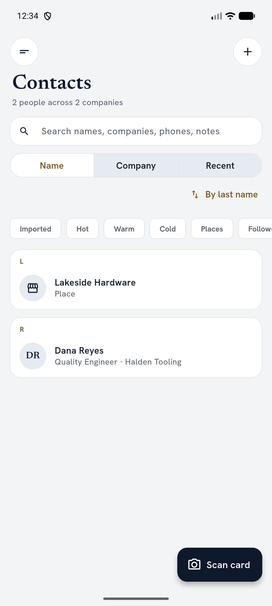
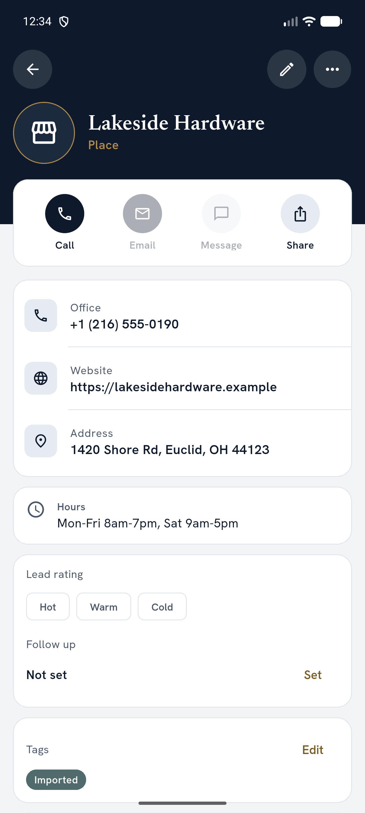
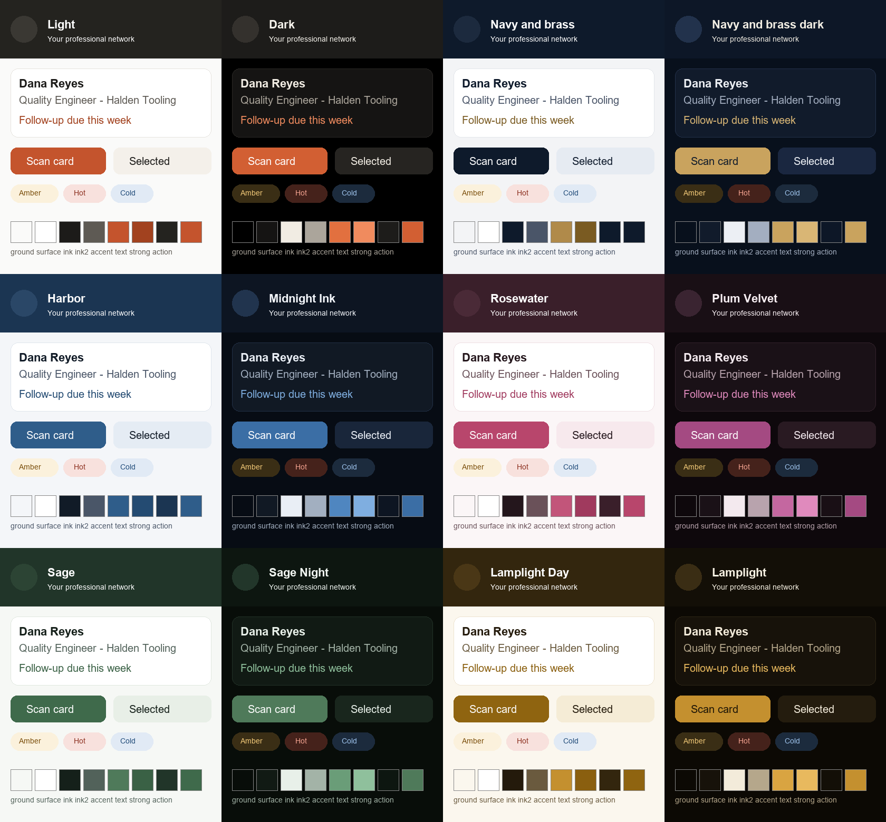

# CardKeep


**A business card organizer that keeps everything on your phone.** Photograph a card and CardKeep straightens it,
reads it, fills in the contact and keeps the card with them. No account, no cloud, no tracking.

<p>
  
  
  
  
</p>

## What it does (0.7)

- **Scan cards with the camera.** It finds the card, waits until it's sharp and steady, and captures by itself.
  Glare, blur, low light and cut-off cards get a hint before the shot and a flag after it.
- **Read on the phone.** The card is straightened and read with on-device text recognition; name, title, company,
  phones, emails, website and address land in the right fields. Anything it isn't sure of is marked for a second look.
- **QR codes too.** A contact QR on the card fills the details exactly. A web-link QR shows the real site, warns about
  link shorteners and look-alike addresses, and only opens when you tap it.
- **Batch and pile.** Shoot a stack of cards one after another, or several on a table in one photo. Clear cards go
  straight to Contacts; the rest wait in a review queue. Nothing is lost if the app closes mid-scan.
- **Sweep scan.** Lay the cards out and move the phone over them: each card is outlined, read on its own and marked
  Done in green as you go.
- **Review fast.** Tap any line of text on the card to put it in a field, or draw a box to read just that part.
- **Your contacts, quickly.** Search by any part of a name, company, email or phone number. Call, text, email, open
  the website or the address in your own apps. Lead ratings, follow-up dates, dated notes and a "check on web" search.
- **Duplicates and merging.** Possible duplicates are found as you add people; merge them side by side, or clean up every
  obvious copy at once (same name plus the same email or phone) with a preview and one Undo.
- **Companies and career moves.** People are grouped by company, and each company has its own page: everyone there now
  and before, its places, the events where you met them, shared phone and website, and the last card date. A new card at another
  company becomes a job change you confirm; retirements and successors are tracked.
- **Tags, events and follow-ups.** Tag anyone, run an event as a scan session so new cards remember where you met, and
  set follow-up dates with reminders on the day.
- **Import, export and backup.** vCard and CSV (Google, Outlook, HubSpot, Salesforce, LinkedIn) in and out, a full
  backup zip you can restore, and an optional weekly or daily automatic backup. Deleted contacts are wiped for good after 7 days (or 14 or 30; you choose), or at once with Delete forever now.
- **Places.** Store, restaurant, vendor and service cards are kept as places: business name, category, opening
  hours, phone, website and address (opens Maps). Found automatically when scanned, with a Person/Place switch on the
  form and a Places filter in Contacts. vCard export marks them as organisations (KIND:org).
- **My card and tap cards (NFC).** Share your own card as a QR code, and read or write NFC business cards.
- **Themes.** Six looks, each with a light and a dark version: CardKeep, Navy and brass, Harbor, Rosewater, Sage and Lamplight. Pick one as a pill in Settings, pin its light or dark side, or follow the phone's dark mode.
- **A guided tour and Help.** A skippable first-run tour explains the privacy promise and every permission before Android asks,
  sets CardKeep up, and teaches the main features with short animated lessons and first-visit tips. Help & tips in the
  menu has searchable lessons and answers, replays the tour, and adds or removes six demo contacts.
- **Updates from inside the app** (Settings → Updates), only when you ask.

<p>
  
  
  
  
  
</p>

<p>
  
  
  
</p>

## Install (Android)

1. Open the [latest release](../../releases/latest) on your phone and download `CardKeep-<version>-arm64-v8a.apk`
   (most phones from the last several years; use `armeabi-v7a` for older 32-bit phones).
2. Open the file and allow installing from your browser or files app when Android asks.
3. Open **CardKeep**.

**Updating:** Settings → Updates → *Check for updates* downloads and installs the new version over the old one.
Your contacts stay. Installing a newer APK by hand works the same way; there's no need to uninstall.

## Install (Windows)

1. From the same [release](../../releases/latest) download `CardKeep-<version>-windows-x64.zip` and unzip it.
2. Run `CardKeep.exe`. It is not code signed: if SmartScreen stops it, choose *More info*, then *Run anyway*.
3. To share the library with your phone: on the phone open *Sync to desktop* and tap *Copy code text*; on the PC open
   *Sync with phone*, paste and press *Pair*. The PC calls the phone over your Wi-Fi, so Windows Firewall needs no rule.

The Windows app has the two-pane list and contact view, Ctrl+F / Ctrl+N / Ctrl+S, drag-and-drop of `.vcf`, `.csv` and
card photos, and remembers its window. It does not scan or tap cards: scanning stays on the phone, and photos added on the
PC wait in the Review queue to be typed in. `SHA256SUMS-windows.txt` checks the zip.

Each release also lists `SHA256SUMS.txt` to check a download. The full guide (permissions, backups before changing
phones, building from source) is the Install Manual in [docs/manual/install-manual.md](docs/manual/install-manual.md);
how to use every screen is in the [User Manual](docs/manual/user-manual.md).

## Privacy

- Your contacts and card photos stay in CardKeep's private storage on the phone. Photos are saved without location
  or camera data.
- Cards are read on the phone; nothing is uploaded. No account, no analytics, no ads.
- Links, calls, emails and maps open in your own apps.
- The only time CardKeep goes online is when you check for updates (it asks GitHub for the latest release and sends
  nothing about you). Checking at startup is off unless you turn it on. Downloads must match GitHub's checksum.
- CardKeep is left out of Android's cloud backup and device transfer, so make a CardKeep backup before changing
  phones. Google's ML Kit usage logging is switched off.
- *Sync to desktop* (when you open it) makes the phone listen on your own Wi-Fi only, with a certificate made on the phone that your PC pins from the QR code. Nothing goes through the internet or a cloud, and Delete everything also unpairs the PC.
- *App lock* (Settings, Privacy) asks your phone to check it is you before CardKeep opens. It is a door, not a safe: the library on the phone is not encrypted.
- Reminders hide the contact on the lock screen; *Hide in recent apps* (Settings) keeps the app out of the app switcher.

## What's next

- **0.7.4 Lock-down (built, not yet released):** app lock (fingerprint, face or device passcode), an action on every empty list, clear error messages, Delete everything, About and licences, grouped Settings.
- **0.8 Desktop:** a Windows app and sync between phone and PC over your own Wi-Fi, no cloud. Built, not yet released: the phone side (drawer → *Sync to desktop*: pairing QR, paired PC, conflict list) and the Windows app (*Sync with phone*, two panes, shortcuts, drag-and-drop). Still to come in 0.8: a trial on real hardware.
- **1.0 Google Play:** audits, accessibility and performance passes, privacy policy and store listing (0.6.2 passed a release audit for GitHub distribution).

The full plan is in [docs/ROADMAP.md](docs/ROADMAP.md); what changed in each version is in [CHANGELOG.md](CHANGELOG.md).

## Building

Flutter 3.47. On Windows, OpenCV builds from source and needs the Android NDK path (see [CLAUDE.md](CLAUDE.md),
Commands and Gotchas).

```bash
flutter pub get
dart run build_runner build --delete-conflicting-outputs
flutter test
flutter run
```

**Windows app:** `flutter run -d windows` / `flutter build windows --release`. Needs Visual Studio 2022 with the
*Desktop development with C++* workload **including the "C++ ATL for latest v143 build tools" component** (the
notifications plugin includes `atlbase.h`; a Build Tools install without ATL fails with "Cannot open include file
atlbase.h"). Add it with `winget install Microsoft.VisualStudio.2022.Community --override "--add Microsoft.VisualStudio.Workload.NativeDesktop --add Microsoft.VisualStudio.Component.VC.ATL"`
or in the Visual Studio Installer → Modify → Individual components.
