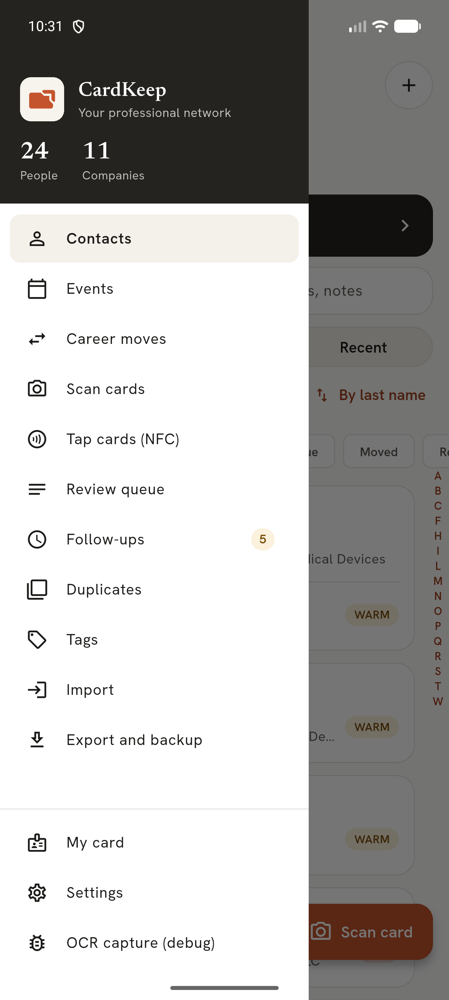
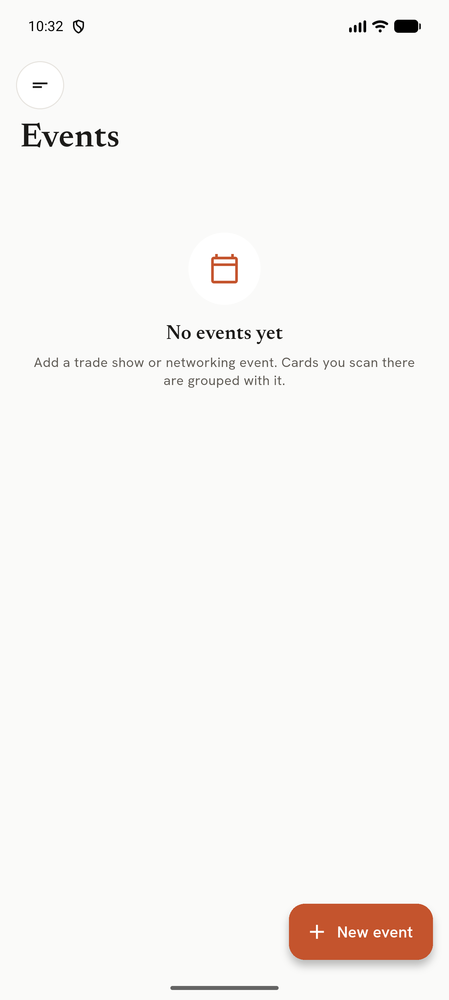
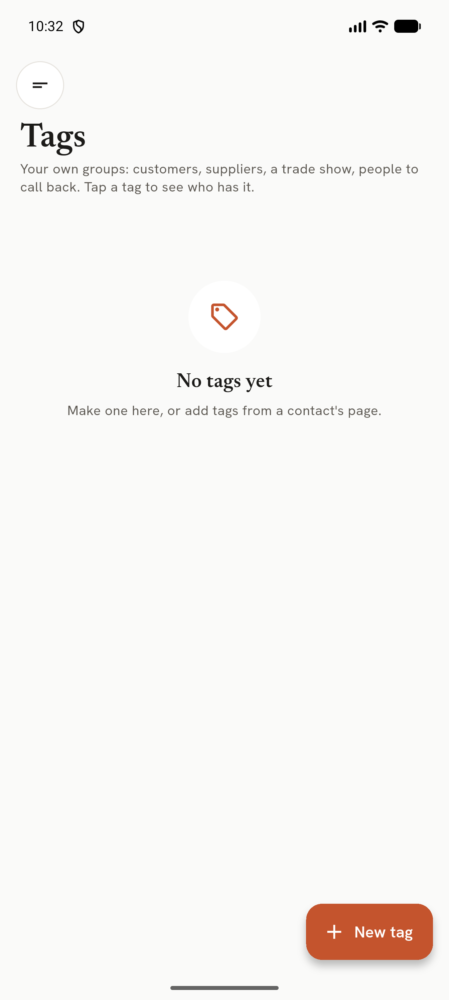
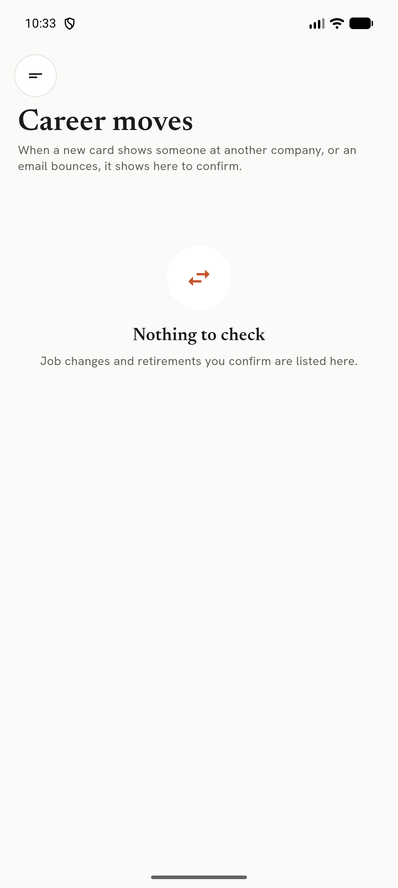
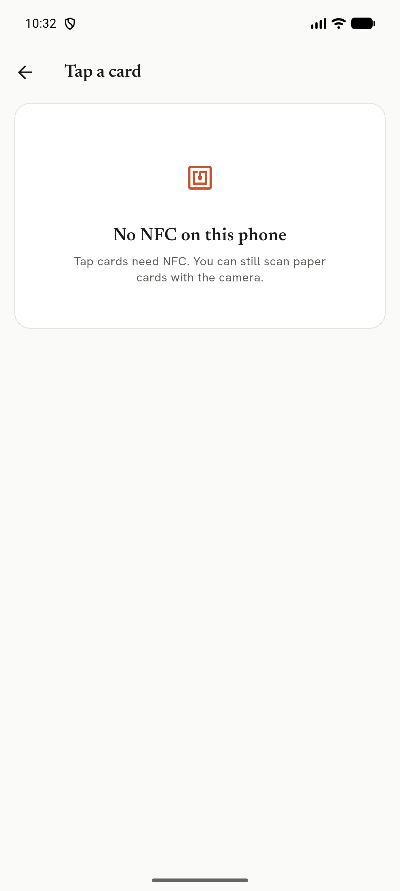
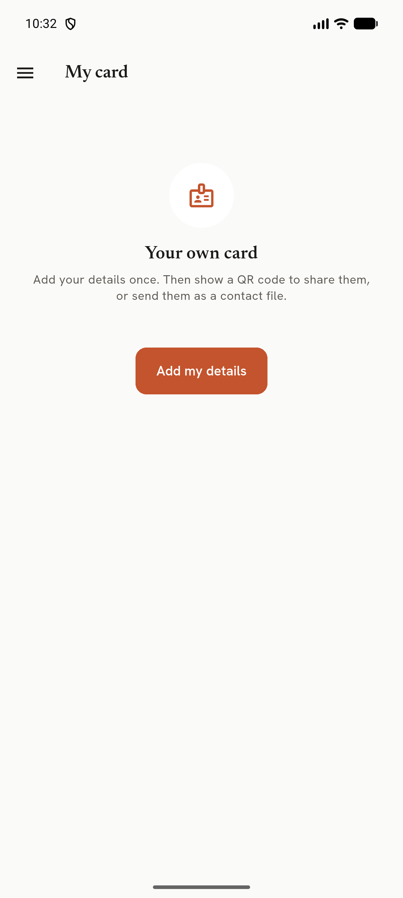
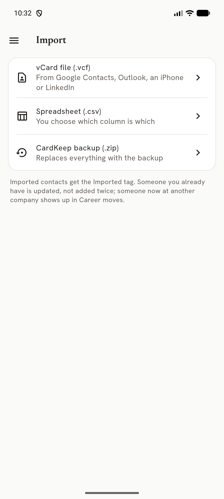

# CardKeep User Manual

**Version 0.7.3 · Android · October 2026**

CardKeep turns the business cards you collect into contacts on your phone. You photograph a card; CardKeep
straightens it, reads it on the phone, fills in the contact and keeps the card with the person. There is no
account and no cloud: everything stays in CardKeep's private storage on your phone.

## I want to...

| I want to... | Go to |
|---|---|
| Scan one card | Scanning cards → One card |
| Scan a stack quickly | Scanning cards → Batch and Pile |
| Fix something the scanner got wrong | Reviewing a scan |
| Find someone | Contacts → Search and filters |
| Remember to follow up | Follow-ups and reminders |
| Group people from a trade show | Events |
| Tag customers or suppliers | Tags |
| Merge two copies of one person | Duplicates |
| See who changed jobs | Career moves |
| Read an NFC business card | Tap cards (NFC) |
| Share my own details | My card |
| Move contacts in or out | Import, Export |
| Keep a copy of everything | Backup and restore |
| Change the look | Settings → Appearance |
| Get the newest version | Settings → Updates |
| Lock CardKeep | Settings → App lock |
| Wipe everything | Settings → Delete everything |
| Find the version or licences | Settings → About |
| Learn the app, or find an answer | The tour and Help & tips |
| Try CardKeep with made-up contacts | Demo data |

---

## 1. Getting around

Open the **menu** with the round button at the top left of Contacts. Every area of CardKeep is listed there:
Contacts, Events, Career moves, Scan cards, Tap cards (NFC), Review queue, Follow-ups, Duplicates, Tags, Import,
Export and backup, Help & tips, My card and Settings. The menu header shows how many people and companies you have.

Back from any area returns to **Contacts**; Back from Contacts leaves the app.

The **+** button at the top right of Contacts offers: Scan a card, Scan a stack, Add by hand, Import card photos and
Tap an NFC card. The orange **Scan card** button at the bottom opens the scanner directly.

## 2. Scanning cards

The first time, Android asks to let CardKeep use the camera. Choose **While using the app**. Without the camera you
can still pick card photos from the gallery.

### One card

1. Tap **Scan card**.
2. Hold the card flat in view, filling about half the width. CardKeep draws its outline and gives one hint at a time:
   *Move closer*, *Hold steady*, *Glare, tilt the card*, *More light*.
3. When the card is sharp and steady it captures by itself. You can also press the shutter.
4. The card is straightened and read. Each detail it finds lights up with a label (Name, Title, Company, Phone,
   Email...).

Top bar: **×** closes the scanner; the lightning button turns the torch on. Tap the preview to focus.
The gallery button (bottom left) picks card photos instead of taking one.

### Batch and Pile

- **Batch**: keep shooting cards one after another. Each is read in the background while you shoot the next.
  Clear cards go straight to Contacts (Settings → *Save clear cards automatically*, on by default); the rest wait
  in the **Review queue**.
- **Pile**: lay several cards on a table and take one photo. Each card is found, straightened and listed.

Every capture is stored on the phone before it is read, so closing the app mid-scan loses nothing: the cards are
read the next time you open CardKeep ("Reading 2 cards left from last time"). A photo that fails to read three times
is set aside and you are told once.

### QR codes on cards

A **contact QR** fills the form exactly and wins over the printed text; where they disagree the field is marked
amber. A **web-link QR** shows its real address, warns about link shorteners, look-alike characters and non-https
links, and opens only when you tap it.

## 3. Reviewing a scan

After a capture you see the card with every detail it found.

- **Use this card** opens the new-contact form, filled in. Fields the reader was unsure of are **amber**: check them.
- **Add the back side** photographs the back; its details fill gaps the front left.
- **Adjust corners** lets you drag the card's corners (with a magnifier) when the edges were not found.
- **Retake** discards this photo.

On the review screen, **tap any line of text** on the card and choose which field it belongs to, or use **Read a
region** to draw a box and read just that part.

Names printed in capitals are re-cased ("FRED PANETO" → "Fred Paneto", keeping McDonald, O'Brien). Phone extensions
("Ext. 112") are kept with the number; fax numbers are kept as their own line and never dialled. Licence numbers,
opening hours and social handles are sorted into labelled lines. A company logo cut from the card becomes the
contact's picture.

Before saving, CardKeep checks for a **possible duplicate** and a **job change** (same person, new company).

### Review queue

Menu → **Review queue** lists cards waiting for you, with counts for cards saved automatically today, cards that need
a quick look, and cards still being read. Tap a card to review it; swipe it away to remove it (with Undo).

## 4. Contacts

- **Search** matches any part of a name, company, title, email, phone digits or notes.
- **Name / Company / Recent** changes the grouping. *By last name* switches to first-name sorting (also in Settings).
- **Filters**: Hot, Warm, Cold, Follow-up due, Moved, Retired, and your tags.
- The **A–Z** strip on the right jumps through the list.
- **Long-press** a contact to select several, then rate, tag, share as vCard or delete them.

### A contact's page

- **Call, Email, Message, Share** across the top. Tap any phone, email, website or address to open it in your
  own apps; **long-press** to copy (copies are marked sensitive so Android hides them from clipboard previews).
- **Lead rating** Hot / Warm / Cold. It can be switched off everywhere in Settings.
- **Follow up**: set a date; you get a reminder that day.
- **Tags**, dated **notes**, the **card** (front and back, tap to zoom), **Others at this company**, and the
  person's career history. **Check on web** searches for them in your browser.
- The pencil edits the contact; **⋯** has Delete, Remove logo and more.

### Adding by hand

**+** → **Add by hand**. Several phones (with a live check that the number is valid) and emails, middle name or
initial, website, address, company and title (suggested from contacts you already have), rating, follow-up, notes.

### Deleting

Delete shows **Undo**. A deleted contact can be brought back for 7 days; after that it is wiped for good, with its
card photos and logo. Deleted contacts are never included in backups.

Settings → Data → **Deleted contacts are kept for** changes the 7 days to 14 or 30. To wipe one contact at once, open its three-dot menu and choose **Delete forever now**; it asks once and cannot be undone.

## 5. Follow-ups and reminders

Menu → **Follow-ups** (or the "due this week" banner on Contacts) lists Overdue, This week and Later. For each:

- **Envelope**: draft the follow-up email in your mail app. It is marked done only when you confirm it was sent.
- **Clock**: push it to tomorrow, 3 days or next week.
- **Tick**: mark it done.

A **reminder notification** arrives on the follow-up day (around 8:00); tapping it opens the contact. Android asks
once for permission. Reminders survive a phone restart. On the lock screen the reminder hides who it is about.

## 6. Events

Menu → **Events** → **New event**: name, dates, location, booth, a contact goal and notes.
**Start scanning for this event** opens a scan session: every card you scan belongs to the event and contacts saved
from it are marked *Met at*. An event page shows the goal ring, cards, contacts, companies and follow-ups.
**Follow up with everyone** sets a follow-up for everyone you met there. Events set to auto-start open their session
the first time you open CardKeep on an event day.

## 7. Tags

Your own groups (customers, suppliers, a trade show) with a name and colour. Create them here or from a contact's page.
Tags become filters on Contacts and are searchable. Deleting a tag asks first and says how many people have it; the
contacts stay.

## 8. Duplicates

People who look like the same person (same mobile, or the same name with the same email or company), each with the
reason. **Compare and merge** lets you pick the name, title and rating per field and combines phones, emails, cards,
tags and notes. **Undo merge** works until CardKeep closes. **Not the same person** is remembered.

## 9. Career moves

When a new card shows someone at another company, or an email bounces, the change appears here to confirm. Confirmed
job changes keep the old role in the person's history; retirements and successors are tracked. Career tracking can be
turned off in Settings, or per contact.

## 10. Tap cards (NFC)

Menu → **Tap cards (NFC)**. Hold an NFC business card to the back of the phone, then the next one; each gives a buzz
and a row. A **contact card** opens the review form; a **link card** can be opened in the browser or saved as a link
(tagged *NFC link*); text can be copied. The same card tapped again within 3 seconds is ignored. Payment cards and
door badges are not read. On a phone without NFC, or with NFC off, the screen says so (with a button to NFC settings).

## 11. My card

**Add my details** once. Then show them as a **QR code** (tap for full screen at full brightness) for someone to scan,
or **send them as a contact file**.

## 12. Import, export, backup

### Import

- **vCard file (.vcf)**: from Google Contacts, Outlook, an iPhone or LinkedIn. You can also open or share a .vcf from
  another app straight into CardKeep.
- **Spreadsheet (.csv)**: a column-matching screen with a preview; the matching is remembered.
- **CardKeep backup (.zip)**: see Restore below.

Imported contacts get the **Imported** tag. Someone you already have is updated, not added twice; someone now at
another company shows up in Career moves.

### Export

Choose **who** (everyone, a tag or an event) and the **format** (vCard 3.0 or 4.0, CSV, HubSpot CSV, Salesforce CSV),
with or without notes, optionally zipped with the card photos. **Share** it or **Save to...** any folder.

### Backup

**Back up now** in Export and backup makes one zip with contacts, card photos, tags, events and settings and lets you
choose where to save it. Keep a copy somewhere safe off the phone (Google Drive, a computer). In Settings → Backups,
**Back up automatically** can be Off, Weekly or Daily (off by default): CardKeep makes one when you open it and one
is due, keeping the last 4 on the phone. **Back up now** there keeps one on the phone straight away and shows when the
last one was made.

CardKeep is excluded from Android's own cloud backup and device-to-device transfer, so **your own backup zip is the
only copy**. Make one before changing phones or reinstalling.

### Restore

**Restore from a backup file...** checks the file first: it refuses damaged files, files that are not CardKeep backups,
files from a newer CardKeep and files over 1 GB. The restore happens the next time CardKeep opens, and is safe even if
the phone turns off in the middle. Afterwards you are told whether it worked.

Your data from before the restore is kept. **Data from before the last restore** (in Export and backup) shows its
date and size: **Go back to it** swaps it back in on the next start; **Discard** deletes it. It is deleted
automatically after 30 days.

## 13. Settings

| Setting | What it does | Default |
|---|---|---|
| Appearance | Match phone, and six looks as pills (CardKeep, Navy and brass, Harbor, Rosewater, Sage, Lamplight), each with a light and a dark version | Match phone, CardKeep |
| Phone region | Country code assumed for numbers without one | Your phone's region |
| Sort names by | First or last name | Last name |
| Career tracking | Suggest job changes from new cards and bounced emails | On |
| Lead ratings | Hot / Warm / Cold everywhere | On |
| Search engine for web checks | Used by Check on web | Google |
| Save clear cards automatically | Batch and Pile: confident cards skip the queue | On |
| Follow-up reminders arrive at | The time of day a follow-up reminder is sent | 8:00 am |
| App lock | Asks for your fingerprint, face or phone passcode to open CardKeep; see App lock below | Off |
| Lock | How long CardKeep may be in the background before it locks: Right away, 1, 5 or 15 minutes | 1 minute |
| Hide in recent apps | Blanks CardKeep in the app switcher and blocks screenshots | Off |
| Back up automatically | Off, Weekly or Daily, kept on the phone (newest 4) | Off |
| Export defaults | Whether exports include notes and card photos | Notes on, photos off |
| Deleted contacts are kept for | 7, 14 or 30 days before they are wiped | 7 days |
| Delete everything | Wipes all contacts, photos and backups on the phone; see below | |
| About | Version, licences, changelog, privacy summary | |
| Updates | Check for updates; optional check at startup | Check at startup off |

Settings is grouped, with a row of chips at the top (Appearance, Contacts, Reminders, Privacy, Backups, Data, Updates,
Help, About) that jump to a section.

### App lock

Settings → Privacy → **App lock**. Your phone checks it is you (fingerprint, face, PIN, pattern or password); CardKeep
has no password of its own. Switching it on asks for one check first, so you cannot lock yourself out, and it stays off
on a phone with no screen lock. **Lock** sets how long CardKeep can sit in the background before it asks again (Right
away, 1, 5 or 15 minutes). While locked CardKeep shows only its logo, the app switcher shows a blank card and
screenshots are blocked. A reminder opens the contact, then CardKeep locks. The same switch is on the last set-up page
of the tour. App lock keeps other people out of the app; it does not encrypt the library.

### Delete everything

Settings → Data → **Delete everything** wipes every contact, company, tag, event, card photo, the review queue and the
backups kept on the phone. It lists what will go, offers **Save a backup first**, and needs you to type **DELETE**.
Tick **Also reset my settings** to put those back to their defaults too. A backup you saved elsewhere is yours and is
never touched.

### About

Settings → **About** shows the version and build, what stays on the phone and what can leave it, what changed in each
version, the open-source licences, the privacy policy, a link to report a problem, and a button that copies the version
details to paste into a report.

### Looks

Each look is a pill with two small groups of colour dots: the left group is its **light** version, the right group its **dark** version. Tap the pill to choose the look and keep the current light or dark mode; tap a group of dots to choose the look and pin that mode (a ring shows the pinned side). **Match phone** switches the light and dark versions with your phone's setting.

| Look | Light | Dark |
|---|---|---|
| CardKeep | Light | Dark |
| Navy and brass | Navy and brass | Navy and brass dark |
| Harbor | Harbor (slate blue) | Midnight Ink |
| Rosewater | Rosewater (dusty rose) | Plum Velvet |
| Sage | Sage (green) | Sage Night |
| Lamplight | Lamplight Day (warm gold) | Lamplight |

Themes you chose in older versions keep working.

### Updates

Settings → **Updates** → **Check for updates** asks GitHub for the latest release, shows what's new, downloads it and
installs it over the current version. Your contacts stay. The download must match the checksum GitHub publishes, or
it is refused. Offline or interrupted downloads say so and can be retried.

## 14. Privacy

- Contacts and card photos stay in CardKeep's private storage. Photos are saved without location or camera data.
- Cards are read on the phone; nothing is uploaded. No account, no analytics, no ads. Google's ML Kit usage logging
  is switched off.
- CardKeep goes online only to check for updates when you ask (or at startup, if you turn that on). It sends nothing
  about you.
- Excluded from Android cloud backup and device transfer.
- Reminders hide the contact on the lock screen; *Hide in recent apps* hides the app's screen in the app switcher. *App lock* asks your phone to check it is you before CardKeep opens.
- Settings → About lists what stays on the phone and what can leave it.

## 15. Troubleshooting

| Problem | Try |
|---|---|
| Scanner keeps saying *Move closer* | Fill about half the screen width with the card; put it on a plain, darker surface. |
| A field is wrong after scanning | On review, tap the right line of text and pick the field, or use Read a region. |
| Edges not found | Adjust corners, or photograph the card on a contrasting surface. |
| Dark or glossy card reads badly | Tilt slightly to remove glare; turn on the torch; dark cards get a second pass automatically. |
| No reminder arrived | Allow notifications for CardKeep in Android settings; check battery optimisation isn't stopping it. |
| "Reading N cards left from last time" | Normal after closing mid-scan; the cards land in the Review queue. |
| Update download failed | Check the connection and tap Check for updates again. |
| Restore was refused | The file is damaged, not a CardKeep backup, from a newer CardKeep, or over 1 GB. |
| Tap cards says no NFC | The phone has no NFC, or it is off: use the button to NFC settings, or scan the card with the camera. |
| "The phone is out of storage" | Free some space (old photos or apps) and try again; nothing already in CardKeep is lost. |
| Some rows were "Not imported" | The result lists each as "Row N: reason" (the header row is row 1); fix those rows in the file and import it again. |
| Locked out of CardKeep | Use the phone's own fingerprint, face or passcode. If the phone fails, the screen lock itself needs resetting in Android. |

## 16. The tour, tips and Help

CardKeep teaches itself, and none of it is compulsory.

### The first-run tour

The first time you open CardKeep it offers a tour of about five minutes. A bar at the top shows where you are
(Welcome, Permissions, Set-up, Lessons, Get started). **Skip tour** is always there; the phone's Back button steps
back one page, and on the first page it asks whether to leave.

- **Welcome (4 pages).** What CardKeep is; your privacy, precisely (nothing is uploaded, the only internet use is the
  update check you can switch on, text on cards is read on the phone, backups stay on the phone and Android's cloud
  backup is off); what is kept and who can see it; how the tour works.
- **Permissions.** One card each for **Camera** and **Notifications**, and one for **NFC** and your phone's contacts.
  Each says why CardKeep asks, what it never does, what happens if you say no and where to change it later, and
  only then offers **Allow**. *Not now* is always fine. CardKeep never asks to read your phone's Contacts.
- **Set-up.** Look (Match phone and the two looks), name order, phone region; lead ratings, career tracking and
  *Save clear cards automatically* with examples of what each does; and the **weekly backup**, which the tour turns
  on unless you switch it off, because a backup is the only safety net.
- **Lessons (8).** Scan one card, Sweep, the Review queue, Person or Place, Tags/events/follow-ups/duplicates, Import,
  export and backup, Tap cards, My card. Each has a short animation, two to four steps and a **Try it** button that
  opens the real screen with a spotlight tip. With *Remove animations* on in Android, the animations stand still.
- **Get started.** Import contacts (with step-by-step help for Google Contacts, Outlook, iPhone and LinkedIn), scan
  your first card, **Start with demo data**, or **Start empty**.

### Demo data

*Start with demo data* adds six made-up contacts (five people and a shop), all tagged **Demo**, so you can try
searching, tags, duplicates and company pages. Remove them all at once from Help & tips or Settings → Help →
**Remove demo data**. Your own contacts are never touched.

### First-visit tips

The first time you open Contacts, the scanner, Sweep, the Review queue, Duplicates or Settings, a spotlight and a
short note point out what matters. Each shows once. Finishing the tour turns tips on; skipping it leaves them off.
**Reset tips** (Help & tips or Settings → Help) shows them all again.

### Help & tips

Open **Help & tips** from the menu: a search box, the eight lessons and short answers, grouped. Search matches
every word you type ("new phone restore"). It also has **Replay the tour**, **Reset tips**, **Report an issue**
(opens CardKeep's issue page on GitHub in your browser) and **About CardKeep**.

### After an update

If you already use CardKeep when this version arrives, you see a short **What's new** sheet instead of the tour:
**Take the tour**, **Show me tips as I go**, or **Not now**.
